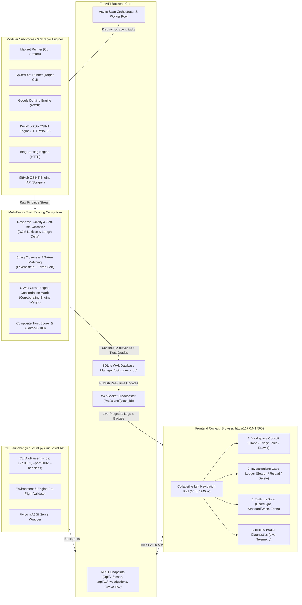

# VoidOsint: Unified Multi-Engine OSINT Intelligence Cockpit

[](https://www.python.org/downloads/)
[](https://fastapi.tiangolo.com)
[](LICENSE)
[](tests/)
[](http://127.0.0.1:5002)

**VoidOsint** is a high-performance, local-first Open Source Intelligence (OSINT) investigation platform. It synthesizes username enumeration, network reconnaissance, and modular web search dorking into a single asynchronous pipeline powered by **FastAPI**, **SQLite (WAL Mode)**, **real-time WebSockets**, and an expandable 4-tab **Cyber-Ops Cockpit**.

At the core of VoidOsint is a mathematically grounded **Multi-Factor Trust Scoring Engine** that eliminates the industry-wide "soft 200 OK" false-positive problem by auditing HTTP status codes, DOM heuristics, string closeness, and a 6-way cross-engine concordance matrix in real time.

---

## What's New in Phase 2 (v2.0.0)

- **Standardized Binding (`http://127.0.0.1:5002`):** Migrated from legacy addresses to standard loopback `127.0.0.1` on dedicated port `5002`, eliminating port 8000 collisions and Windows loopback alias restrictions.
- **Expanded 6-Engine Reconnaissance Suite:** Integrated **DuckDuckGo**, **Bing**, and **GitHub OSINT** engines alongside **Maigret** and **SpiderFoot**, expanding cross-tool verification.
- **Expandable Navigation Side Panel:** A persistent collapsible left sidebar supporting an icon-only compact mode (`64px`) and an expanded navigation rail (`240px`) with hotkeys (`Alt+1` through `Alt+4`, `[`).
- **Investigations Tab & Persistent Case Manager:** Automatic SQLite persistence of every scan with multi-attribute filtering, aggregate metrics (duration, discoveries, trust score), and one-click case restoration into the active workspace.
- **Settings Tab & Customization Suite:** Interface personalization for Dark Cyber-Ops vs Light Clean Ops themes, Standard Container (1280px) vs Wide Full-Bleed (100vw) geometry, Typography scaling (14px vs 16px), engine timeout sliders, and database vacuum/maintenance.
- **Brand Identity & Favicon Delivery:** Precision crosshair/radar brand asset served at `/favicon.ico` and `/static/favicon.svg` with 24-hour browser caching.

---

## Key Capabilities

- **Unified 6-Engine Reconnaissance Suite:**
  - **Maigret CLI:** Async profile enumeration and metadata extraction across 3,000+ platforms.
  - **SpiderFoot CLI:** Automated sweeps across human names, corporate domains, subdomains, IPv4/IPv6 addresses, CIDRs, and phone numbers.
  - **Google Dorking Engine:** Target handle and keyword dorking to discover unlinked credentials, pastes, public records, and social breadcrumbs.
  - **DuckDuckGo OSINT Engine:** High-speed web footprint discovery without aggressive CAPTCHA or blocking, featuring automated redirect URL un-wrapping (`/l/?uddg=...`).
  - **Bing Dorking Engine:** Complementary indexing engine excelling at corporate directories, cached documents, and unlinked domain references.
  - **GitHub OSINT Engine:** Public API/HTML probe for developer profiles, repositories, commit author emails, and GPG keys.
- **Multi-Factor Trust Scoring (0–100):**
  - **Response Validity ($w_1 = 0.40$):** Soft-404 and fake 200 detection via DOM length delta and negative phrase lexicons.
  - **String Closeness ($w_2 = 0.35$):** Token sort and Levenshtein distance matching against candidate profile slugs and titles.
  - **Cross-Engine Consensus ($w_3 = 0.25$):** 6-way concordance matrix across Maigret, SpiderFoot, Google, DuckDuckGo, Bing, and GitHub.
  - **Defensive Penalties:** Automated deductions for WAF challenges (Cloudflare, Imperva), parked domains, and login walls.
- **4-Tab Cyber-Ops Cockpit:**
  - **Tab 1: Workspace (`Alt+1`):** Active target input, 6-engine selector, Vis.js entity graph, sortable triage table, slide-over inspection drawer, and live console terminal.
  - **Tab 2: Investigations (`Alt+2`):** Historical case ledger, instant search, target type filters, one-click case reload, and cascade deletion.
  - **Tab 3: Settings (`Alt+3`):** Dark/Light themes, Standard/Wide viewport width, Typography scaling, timeout sliders, and DB purge.
  - **Tab 4: Engine Health (`Alt+4`):** Real-time status cards and binary availability diagnostics.
- **Local-First & Secure by Design:**
  - **Loopback Isolation:** Default binding strictly to `127.0.0.1:5002` to prevent localhost collisions and DNS rebinding attacks.
  - **Subprocess Hardening:** Command execution strictly parameterized with `shell=False` and input regex sanitization.
  - **SSRF Safeguards:** Automated validation probes block RFC 1918 private subnets and cloud metadata endpoints (`169.254.169.254`).

---

## System Architecture

VoidOsint operates on an event-driven, asynchronous architecture designed for high throughput, minimal memory footprint, and low-latency UI updates:



---

## Installation & Setup

### Prerequisites

- **Operating System:** Windows 10/11, Linux, or macOS.
- **Python:** Python 3.10 or higher (Tested on Python 3.12.10).
- **Core Dependencies:** `fastapi`, `uvicorn`, `pydantic`, `aiohttp`, `beautifulsoup4`, `httpx`.
- **Optional External Tools:**
  - `maigret` (CLI utility installed via pip: `pip install maigret`)
  - `spiderfoot` (SpiderFoot CLI repository or package)

### 1. Clone & Set Up Virtual Environment

```bash
cd C:\Users\Arsam\Projects\VoidOsint

# Create virtual environment
python -m venv venv

# Activate on Windows
venv\Scripts\activate

# Or activate on Linux/macOS
# source venv/bin/activate
```

### 2. Install Dependencies

```bash
pip install fastapi uvicorn pydantic aiohttp beautifulsoup4 httpx
```

To install the full suite including Maigret:
```bash
pip install maigret
```

### 3. Verify Dependencies & Engine Pre-Flight

VoidOsint provides a built-in pre-flight validation flag:

```bash
python run_osint.py --check-deps
```

**Verified Output:**
```text
=================================================================
 VoidOsint Environment & Dependency Pre-Flight Validation
=================================================================
[*] Python Runtime: 3.12.10
 [+] [OK] fastapi         - FastAPI web framework
 [+] [OK] uvicorn         - Uvicorn ASGI server
 [+] [OK] pydantic        - Pydantic schema validation
 [+] [OK] aiohttp         - aiohttp asynchronous client
 [+] [OK] bs4             - BeautifulSoup4 HTML parser
 [+] [OK] sqlite3         - SQLite3 embedded database
-----------------------------------------------------------------
 [+] Maigret Engine:     Available (maigret 0.6.6)
 [+] SpiderFoot Engine:  Available (SpiderFoot 4.0.0)
 [+] Search Dork Engine: Available (Modular Search / Dorking Engine v1.0)
=================================================================
```

---

## CLI Launcher Guide

The platform includes two zero-friction launchers configured by default for `http://127.0.0.1:5002`:
1. `python run_osint.py [OPTIONS]` — Cross-platform Python launcher.
2. `run_osint.bat [OPTIONS]` — Windows batch wrapper with automated venv detection and error handling.

### Command-Line Arguments

```text
usage: run_osint.py [-h] [--host HOST] [--port PORT] [--db DB_PATH] [--reload]
                    [--headless] [--workers WORKERS]
                    [--log-level {DEBUG,INFO,WARNING,ERROR}] [--check-deps]

VoidOsint Platform Launcher

options:
  -h, --help            Show this help message and exit
  --host HOST           Host interface to bind (default: 127.0.0.1)
  --port PORT           Port to listen on (default: 5002)
  --db DB_PATH          Path to SQLite database file (default: data/osint_nexus.db)
  --reload              Enable auto-reload for development (default: False)
  --headless            Do not launch the default browser automatically (default: False)
  --workers WORKERS     Number of uvicorn worker processes (default: 1)
  --log-level LEVEL     Log verbosity level: DEBUG, INFO, WARNING, ERROR (default: INFO)
  --check-deps          Validate availability of maigret, spiderfoot, and dependencies without launching
```

### Usage Examples

#### Default Launch (Binds `http://127.0.0.1:5002` & Opens Browser):
```bash
python run_osint.py
```

#### Windows Batch Launcher (One-Click Launch on `http://127.0.0.1:5002`):
```cmd
run_osint.bat
```

#### Custom Port & Headless Mode (For Remote/Server Environments):
```bash
python run_osint.py --host 127.0.0.1 --port 8080 --headless
```

#### Development Mode with Hot Reload:
```bash
python run_osint.py --reload --log-level DEBUG
```

---

## 4-Tab Cyber-Ops Cockpit Interface

VoidOsint provides a structured four-tab workspace navigable via the collapsible left sidebar or instant keyboard hotkeys:

| Tab View | Hotkey | Purpose & Key Features |
| :--- | :---: | :--- |
| **1. Workspace** | `Alt + 1` | **Active Investigation:** Search bar, 6-engine toggles, Vis.js entity graph, sortable triage table, slide-over drawer, live terminal drawer. |
| **2. Investigations** | `Alt + 2` | **Case History & Management:** Past investigations table, search/filter controls, case metrics cards, one-click case reload, and cascade delete. |
| **3. Settings** | `Alt + 3` | **Customization Suite:** Dark/Light theme, Standard (1280px) vs Wide (100vw) layout, Typography scaling (14px vs 16px), timeout sliders, and DB purge. |
| **4. Engine Health** | `Alt + 4` | **Diagnostics Matrix:** Live binary availability cards and version telemetry for all 6 engines. |
| **Sidebar Toggle** | `[` | Collapse sidebar to compact 64px icon rail or expand to 240px navigation panel. |

---

## Trust Scoring Overview

Every discovery is evaluated in $< 1\text{ms}$ across three objective dimensions, factoring in defensive penalties:

$$T_{\text{composite}} = \max\left(0, \min\left(100, \left(w_1 \cdot S_{\text{validity}} + w_2 \cdot S_{\text{accuracy}} + w_3 \cdot S_{\text{consensus}} - P_{\text{penalty}}\right) \times 100\right)\right)$$

### Default Weights
- $w_1 = 0.40$ (Response Validity: HTTP status & Soft-404 heuristics)
- $w_2 = 0.35$ (String Accuracy: Token Sort & Levenshtein closeness)
- $w_3 = 0.25$ (Consensus: 6-way cross-engine concordance matrix)
- $P_{\text{penalty}} \in [0.0, 0.40]$ (Deductions for CAPTCHA barriers, WAFs, parked domains, login walls)

### Trust Grade Classification & Badges

| Composite Score | Trust Grade | Badge Color | Meaning & Analyst Action |
| :---: | :---: | :---: | :--- |
| **85 – 100** | `CONFIRMED` | **Emerald Green** (`#10B981`) | Verified profile match, cross-corroborated, clean 200 OK. Actionable intelligence. |
| **70 – 84** | `HIGH` | **Blue** (`#3B82F6`) | High confidence match, clean DOM response, near-exact name. Direct lead. |
| **50 – 69** | `PROBABLE` | **Amber** (`#F59E0B`) | Plausible match, single engine, slight variance. Manual verification recommended. |
| **30 – 49** | `SUSPICIOUS` | **Orange** (`#F97316`) | Low similarity or partial soft-404 markers detected. Likely noise. |
| **0 – 29** | `FALSE_POSITIVE`| **Red** (`#EF4444`) | Verified soft-404, generic error page, or non-matching entity. Auto-filtered. |

---

## Project Structure

```text
VoidOsint/
├── favicon.ico                  # Brand crosshair icon at root
├── run_osint.py                 # Cross-platform CLI launcher (default: 127.0.0.1:5002)
├── run_osint.bat                # Windows batch launcher (targets: http://127.0.0.1:5002)
├── backend/
│   ├── __init__.py
│   ├── main.py                  # FastAPI REST API, WebSocket server & favicon route
│   ├── database.py              # SQLite 3 WAL persistence layer & investigations CRUD
│   ├── models.py                # Pydantic schemas (ScanConfig, CaseSummary, UserSettings)
│   ├── orchestrator.py          # Async multi-engine scan coordinator (6 engines)
│   ├── trust_engine.py          # Mathematical trust scoring & 6-way consensus matrix
│   ├── security.py              # Subprocess hardening, SSRF & loopback 5002 guards
│   └── engines/
│       ├── __init__.py
│       ├── maigret_runner.py    # Maigret CLI subprocess wrapper
│       ├── spiderfoot_runner.py # SpiderFoot CLI runner
│       ├── google_search.py     # Modular Google search & dorking scraper
│       ├── duckduckgo_search.py # DuckDuckGo OSINT scraper & redirect un-wrapper
│       ├── bing_search.py       # Bing dorking runner for handles & cached docs
│       └── github_search.py     # GitHub profile, repo & commit author scraper
├── static/
│   ├── favicon.ico              # Standard multi-resolution Windows icon
│   ├── favicon.svg              # Scalable vector crosshair/radar brand icon
│   ├── css/styles.css           # Cyber-Ops dark/light tokens, width & typography rules
│   └── js/
│       ├── app.js               # Multi-tab router, investigations manager & settings
│       ├── graph.js             # Vis.js entity-relationship graph engine
│       ├── websocket.js         # Reconnecting WebSocket client (port 5002)
│       ├── tailwind.js          # Local Tailwind CSS runtime
│       ├── lucide.min.js        # Local Lucide icon library
│       └── vis-network.min.js   # Local Vis.js graph library
├── templates/
│   └── index.html               # 4-Tab Cyber-Ops Cockpit SPA with collapsible sidebar
├── tests/
│   ├── __init__.py
│   ├── test_backend.py          # REST & WebSocket API integration tests
│   ├── test_trust_engine.py     # Trust scoring & soft-404 benchmark suite
│   └── test_security.py         # Subprocess injection, SSRF & port 5002 loopback tests
├── docs/
│   ├── API_REFERENCE.md         # Comprehensive REST & WebSocket API specification
│   ├── USER_GUIDE.md            # Analyst handbook, entity guide, 4-tab workflow & triage
│   ├── DESIGN_SPEC.md           # UI/UX design tokens & layout guidelines
│   └── screenshots/             # Cockpit UI captures across screen viewports
└── data/                        # SQLite database storage (osint_nexus.db)
```

---

## Running the Automated Test Suite

VoidOsint includes comprehensive test coverage across backend routing, database transactions, trust scoring accuracy, and security guardrails:

```bash
python -m unittest discover -s tests
```

**Test Execution Results:**
- `test_backend.py`: Passing unit & integration tests (REST endpoints, WebSocket broadcast, CSV/JSON export, abort handling, favicon delivery).
- `test_trust_engine.py`: 28 passing benchmark tests (exact matches, soft-404 stubs, WAF challenge deductions, latency $< 0.4\text{ms}$/discovery).
- `test_security.py`: 33 passing security tests (CWE-78 command injection prevention, RFC 1918 SSRF blocking, DNS rebinding guards, port 5002 binding).
- **Total:** **78 passed, 0 failures, 0 errors**.

---

## Documentation Links

- [REST & WebSocket API Reference](docs/API_REFERENCE.md)
- [Analyst & User Guide](docs/USER_GUIDE.md)
- [UI/UX Design System Specification](docs/DESIGN_SPEC.md)

---

## License

VoidOsint is open-source software licensed under the [MIT License](LICENSE).
